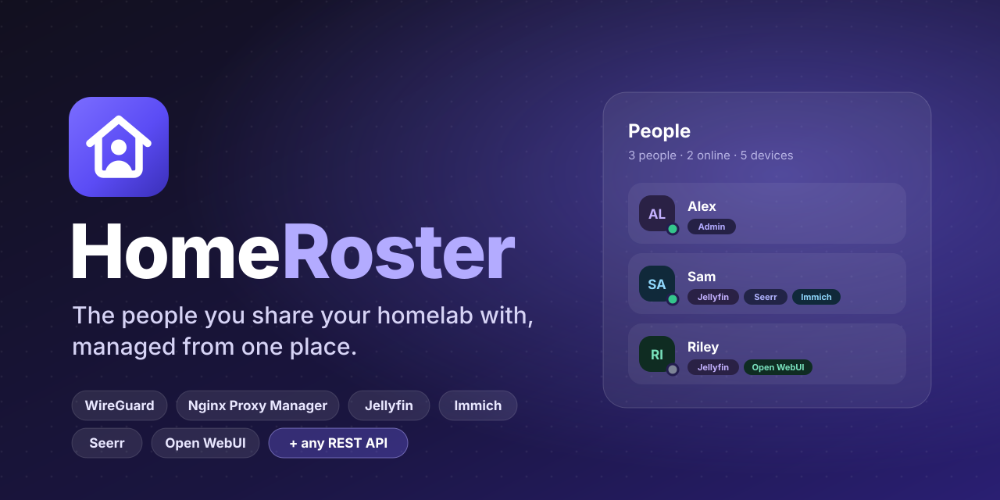
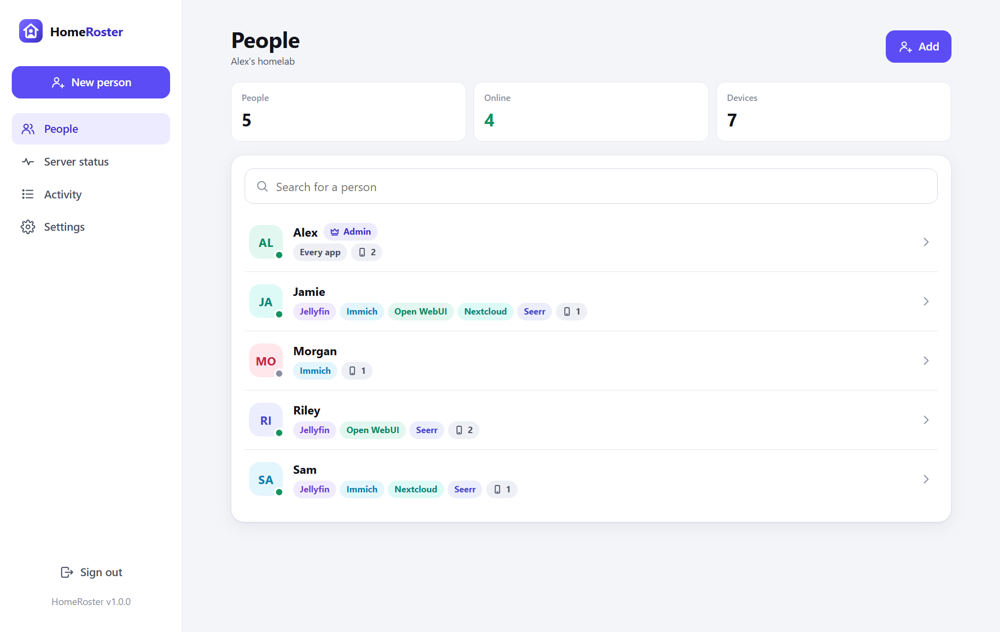
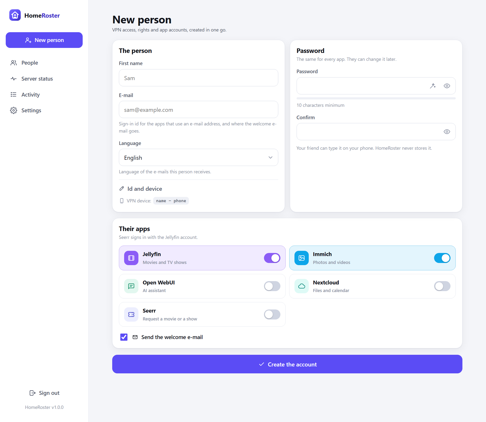
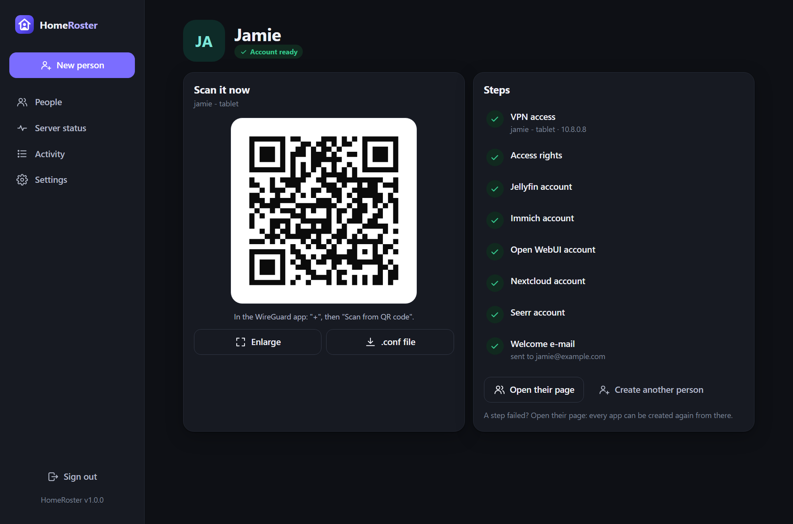
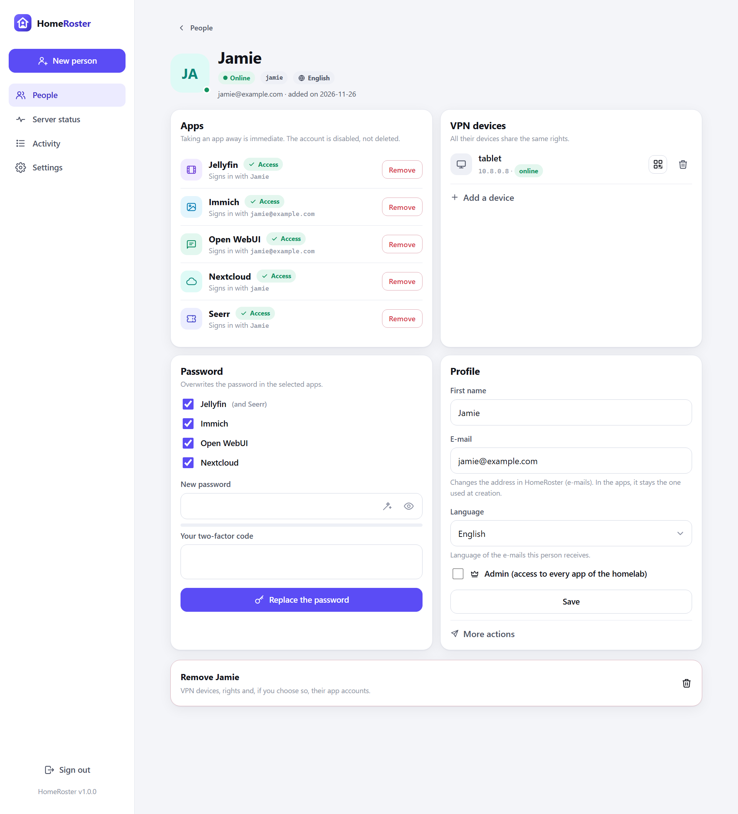
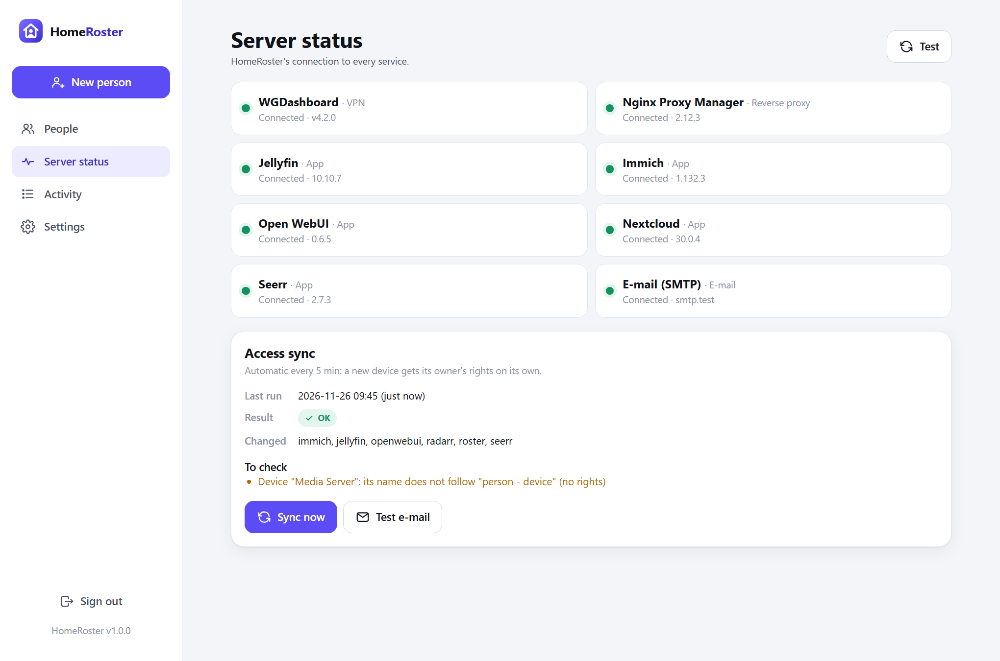
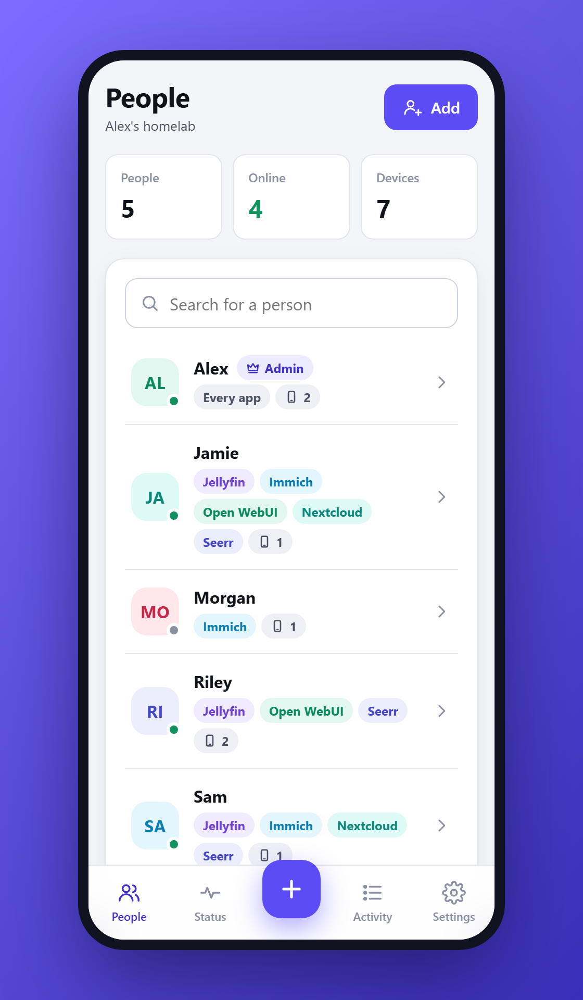
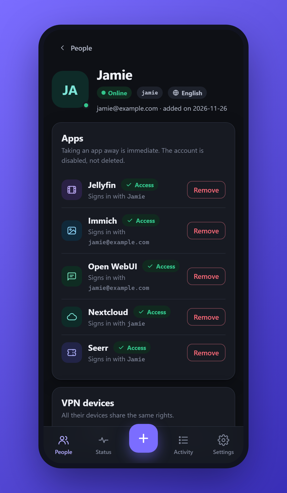
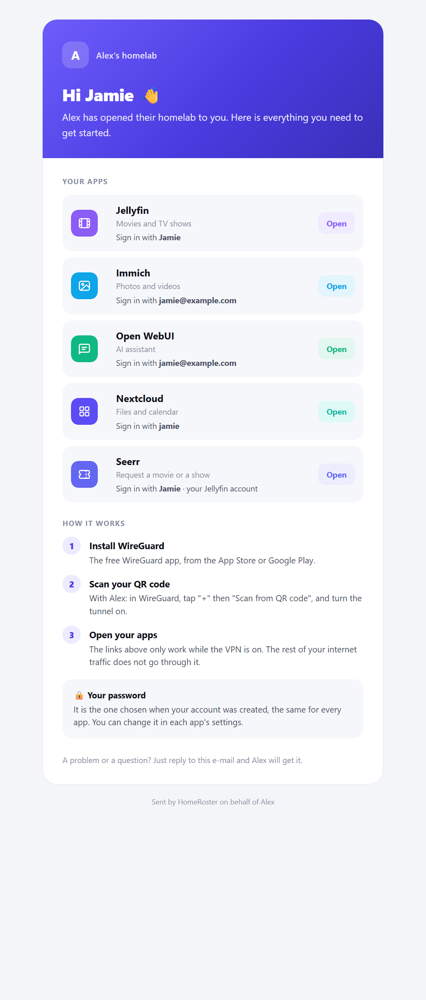
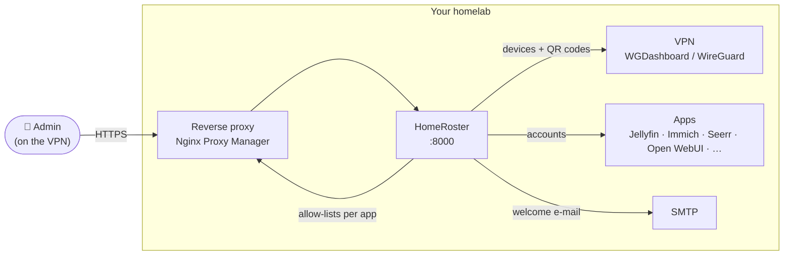

<div align="center">



<p>
  <a href="https://github.com/MaxenceMARTIN45/homeroster/actions/workflows/ci.yml"></a>
  <a href="LICENSE"></a>
  
  
  
</p>

<p><b>Add a friend to your homelab in one tap.</b><br>
VPN device with its QR code, reverse-proxy access rules, accounts in every app and a welcome e-mail:<br>
HomeRoster creates them together, keeps them in sync and removes them just as cleanly.</p>

<p>
  <a href="#-quick-start">Quick start</a> ·
  <a href="#-features">Features</a> ·
  <a href="#-how-it-works">How it works</a> ·
  <a href="#-add-any-service">Add a service</a> ·
  <a href="AGENTS.md">Guide for AI agents</a>
</p>

</div>

---

## 🏡 Why HomeRoster?

You run Jellyfin, Immich, Seerr, Open WebUI… behind a WireGuard VPN and a reverse proxy, and you share them
with your family and friends. Every new person means the same chores:

1. create a VPN peer, then show them its QR code;
2. allow their VPN IP in the reverse proxy, app by app;
3. create an account in each app, with the same password;
4. explain how it all works.

And when someone leaves, or loses their phone, you have to undo all of it without forgetting anything.

**HomeRoster turns this into one form.** It is a small, self-hosted, admin-only web app that becomes the
*source of truth* for who can open what, and drives your VPN, reverse proxy and apps through their APIs.

## ✨ Features

| | |
|---|---|
| ⚡ **One-tap onboarding** | Name, e-mail, password, apps → VPN device + QR code, proxy rights, app accounts and welcome e-mail, with live progress. |
| 🔐 **Access rights in sync** | Proxy allow-lists are rebuilt from HomeRoster's database every 5 minutes. A device added by hand in the VPN gets its owner's rights automatically. |
| 🧩 **Modular by design** | VPN, reverse proxy, mailer and apps are plugins. Swap NPM or WireGuard, or add an app with a few lines of YAML. |
| 📱 **Mobile first** | Built for your phone, next to a friend: QR code full screen, `.conf` download, installable as a web app. Light and dark themes. |
| 🌍 **Multilingual** | English and French included. The interface language is picked at setup; each person gets e-mails in their own language. One JSON file per language. |
| ✉️ **Beautiful welcome e-mail** | App logos, sign-in ids, step-by-step VPN instructions. Never the password. |
| 🛡️ **Secure by default** | Admin only, mandatory TOTP, argon2, strict CSP, CSRF tokens, brute-force throttling, read-only container, no password ever stored. |
| 🧯 **Safe operations** | Each step is independent, errors are readable, a sync never runs without an admin device (you cannot lock yourself out), removing an app disables the account instead of deleting it. |

## 📸 Screenshots

<p align="center">
  <picture>
    <source media="(prefers-color-scheme: dark)" srcset="docs/assets/screenshots/people-dark.png">
    
  </picture>
</p>

<table>
  <tr>
    <td width="50%"><p align="center"><sub>One form for everything</sub></p></td>
    <td width="50%"><p align="center"><sub>Live progress, QR code ready to scan</sub></p></td>
  </tr>
  <tr>
    <td width="50%"><p align="center"><sub>Apps, devices, password and profile of a person</sub></p></td>
    <td width="50%"><p align="center"><sub>Health of every connected service</sub></p></td>
  </tr>
</table>

<p align="center">
  
  &nbsp;
  
  &nbsp;
  
</p>

## 🧭 How it works



* Every device is named **`<person> - <device>`** (`sam - phone`). That convention links a VPN IP to a person.
* HomeRoster's database says which person may open which app. From it, each proxy host gets an access list:
  the VPN IPs of the people granted that app, plus the admins, then *deny all*. Sites that are not managed apps
  (dashboards, \*arr apps, HomeRoster itself) stay **admin-only**.
* Apps are only reachable through the VPN, so the proxy rules are the real gate; app accounts are the second lock.

The full model, its safety rules and its edge cases are documented in [AGENTS.md](AGENTS.md#access-model).

## 🚀 Quick start

**Requirements:** a Docker host on your LAN, a WireGuard server managed by [WGDashboard](https://github.com/donaldzou/WGDashboard),
[Nginx Proxy Manager](https://nginxproxymanager.com/) with your apps as proxy hosts, and API keys for the apps.

```bash
git clone https://github.com/MaxenceMARTIN45/homeroster.git
cd homeroster
bash scripts/install.sh
```

The installer asks for the language, your name, your domain and your reverse proxy IP, creates
`config/homeroster.yaml`, lets you adjust the service URLs, then asks for every secret the file references
and stores them in `.env` (mode 600). It builds the image, starts it and tests every connection.

Then create a proxy host such as `roster.example.com → http://<docker host>:8000`, open it from your phone,
pick your language, create the admin account and scan the two-factor QR code. That's it.

<details>
<summary><b>What each service needs</b></summary>

| Service | Where | What |
|---|---|---|
| **WGDashboard** | Settings → *WGDashboard API Keys* | Enable API keys and create one |
| **Nginx Proxy Manager** | *Users* → *Add User* | A dedicated user (not admin) with *Proxy Hosts* and *Access Lists* set to **Manage**, the rest *Hidden* |
| **Jellyfin** | Dashboard → *API Keys* | A key named `HomeRoster` |
| **Seerr** | Settings → *General* | The API key |
| **Immich** | Account settings → *API Keys* (admin) | Permissions `adminUser.create`, `adminUser.read`, `adminUser.update`, `adminUser.delete` |
| **Open WebUI** | Admin panel → Settings → *General* | Enable API keys, then create one in your account settings (`sk-…`) |
| **SMTP** | Your provider | For Gmail, an [app password](https://myaccount.google.com/apppasswords) |

</details>

<details>
<summary><b>Day-to-day</b></summary>

| I want to… | In HomeRoster |
|---|---|
| Add a friend | **+** → name, e-mail, password (they can type it), apps → **Create** → let them scan the QR code |
| Give or take an app | Their page → *Apps* → **Give** / **Remove** (removal is immediate; the account is disabled, not deleted) |
| Add a device (TV, laptop…) | Their page → *VPN devices* → *Add a device* → QR code |
| Reset a password | Their page → *Password* → pick the apps, type it, confirm with your 2FA code |
| Remove someone | Their page → *Remove* → type their name and your 2FA code |
| Check everything | *Server status*: every service, the last access sync and what needs attention |

</details>

## 🧩 Add any service

HomeRoster is a set of small, replaceable parts. Each one is a plugin registered under a name used in
`config/homeroster.yaml`:

| Part | Included | Replace it by implementing |
|---|---|---|
| VPN | `wgdashboard` (WireGuard) | [`VpnProvider`](src/homeroster/providers/vpn/base.py): list / create / delete devices, export a client config |
| Reverse proxy | `npm` (Nginx Proxy Manager) | [`AccessProxy`](src/homeroster/providers/proxy/base.py): apply an IP allow-list policy to every site |
| Mailer | `smtp` | [`Mailer`](src/homeroster/providers/mail/base.py) |
| Apps | `jellyfin`, `seerr`, `immich`, `openwebui`, **`rest`** | [`AppConnector`](src/homeroster/providers/apps/base.py): create / find / disable / delete an account |

### With YAML only

Most apps expose a user-management REST API. Describe it and the generic `rest` connector does the rest.
Here is Nextcloud:

```yaml
apps:
  nextcloud:
    connector: rest
    label: Nextcloud
    description: {en: Files and calendar, fr: Fichiers et agenda}
    icon: cloud
    url: http://nextcloud.lan
    auth: {type: basic, username: "${NEXTCLOUD_ADMIN_USER}", password: "${NEXTCLOUD_ADMIN_PASSWORD}"}
    headers: {OCS-APIRequest: "true"}
    success: {field: ocs.meta.statuscode, equals: [100, 200]}
    endpoints:
      create:       {method: POST, path: "/ocs/v1.php/cloud/users?format=json", id: "{username}",
                     form: {userid: "{username}", password: "{password}", email: "{email}", displayName: "{name}"}}
      set_password: {method: PUT, path: "/ocs/v1.php/cloud/users/{id}?format=json", form: {key: password, value: "{password}"}}
      disable:      {method: PUT, path: "/ocs/v1.php/cloud/users/{id}/disable?format=json"}
      enable:       {method: PUT, path: "/ocs/v1.php/cloud/users/{id}/enable?format=json"}
      delete:       {method: DELETE, path: "/ocs/v1.php/cloud/users/{id}?format=json"}
```

Run `bash scripts/install.sh` again to fill in the new secrets, then `bash scripts/install.sh --update`.

### With a few lines of Python

```python
from homeroster.providers.apps.base import Account, AppConnector, Person
from homeroster.providers.base import HttpService
from homeroster.providers.registry import register_app


@register_app("audiobookshelf")
class Audiobookshelf(AppConnector):
    default_label = "Audiobookshelf"
    default_icon = "book"

    def __init__(self, app_id, options, *, domain):
        super().__init__(app_id, options, domain=domain)
        self.http = HttpService(self.label, options["url"], headers={"Authorization": f"Bearer {options['api_key']}"})

    async def create(self, person: Person, password, parent=None) -> Account:
        user = await self.http.request("POST", "/api/users", json={"username": person.slug, "password": password, "type": "user"})
        return Account(user["user"]["id"], person.slug)

    async def delete(self, account: Account) -> None:
        await self.http.request("DELETE", f"/api/users/{account.external_id}")
```

Put the module in the package, or anywhere on the Python path and list it under `homeroster.plugins`.
The step-by-step recipe (tests included) is in [AGENTS.md](AGENTS.md#recipes).

## 🌍 Languages

Every string lives in [`src/homeroster/locales/<code>.json`](src/homeroster/locales): English keys, translated
values. To add a language, copy `en.json` to `de.json`, translate the values, restart. It shows up in the
setup screen, the settings and the per-person e-mail language automatically. A test checks that every file
has the same keys and placeholders.

## 🛡️ Security

* Admin-only interface: argon2 password **and** TOTP, replay-protected codes, 5 attempts per 15 minutes per IP.
* Sessions: `HttpOnly`, `Secure`, `SameSite=Strict` cookies, idle and absolute timeouts, new token after sign-in.
* Every form carries a CSRF token; destructive actions also require a fresh 2FA code.
* Strict Content-Security-Policy (no inline script or style), `X-Frame-Options: DENY`, no third-party resource.
* Secrets live in `.env` (mode 600), never in the YAML file, the database or the logs. User passwords are never stored.
* The container runs as an unprivileged user on a read-only filesystem with every capability dropped.

Found a vulnerability? Please read [SECURITY.md](SECURITY.md).

## 🤖 For AI agents

Using Claude, Copilot, Cursor or another agent to install or adapt HomeRoster? Point it to
[**AGENTS.md**](AGENTS.md): a dense technical guide with the repository map, the invariants, the access
model, the installation procedure and recipes to add a VPN, a proxy, an app or a language.

## 🛠️ Development

```bash
python -m venv .venv && . .venv/bin/activate      # Windows: .venv\Scripts\activate
pip install -r requirements-dev.txt
pytest                                           # end-to-end tests against a simulated homelab
ruff check src tests scripts
python tests/demo_server.py                      # the real UI on http://127.0.0.1:8765, made-up data
python scripts/take_screenshots.py               # refresh the README screenshots
```

Contributions are welcome: see [CONTRIBUTING.md](CONTRIBUTING.md).

## 📄 License

[MIT](LICENSE): use it, change it, sell it, ship it. Just keep the notice.

<div align="center"><sub>Made for homelabs shared with the people we love.</sub></div>
