<div align="center">


<p>
  <a href="https://github.com/MaxenceMARTIN45/HomeRoster/actions/workflows/ci.yml"></a>
  <a href="LICENSE"></a>
  
  
  
  
</p>

<p><b>Open your homelab to your family and friends in one tap.</b><br>
VPN device with its QR code, reverse-proxy access rules, accounts in every app and a welcome e-mail:<br>
HomeRoster creates them together, keeps them in sync and removes them just as cleanly.</p>

<p>
  <a href="#-quick-start">Quick start</a> ·
  <a href="#-features">Features</a> ·
  <a href="#-how-it-works">How it works</a> ·
  <a href="#-add-any-service">Add a service</a> ·
  <a href="AGENTS.md">Guide for AI agents</a>
</p>

</div>

> [!TIP]
> **Proxmox VE?** Install HomeRoster in a container with one command, in the Proxmox shell:
>
> ```bash
> bash -c "$(curl -fsSL https://raw.githubusercontent.com/MaxenceMARTIN45/HomeRoster/develop/scripts/proxmox/homeroster-lxc.sh)"
> ```
>
> Then type `update` in the container whenever you want the latest version. [Step-by-step guide ↓](#on-proxmox-ve-one-command)

---

## 🏡 Why HomeRoster?

You run Jellyfin, Seerr, Immich, Open WebUI, Vaultwarden, Home Assistant, Nextcloud… behind a VPN (WireGuard, Tailscale…) and a reverse proxy, and
you share them with your family and friends. Every new person means the same chores:

1. create their VPN access, then show them its QR code or invitation;
2. allow their VPN IP in the reverse proxy, app by app;
3. create an account in each app, with the same password;
4. explain how it all works.

And when someone leaves, or loses their phone, you have to undo all of it without forgetting anything.

**HomeRoster turns this into one form.** It is a small, self-hosted, admin-only web app that becomes the
*source of truth* for who can open what, and drives your VPN, reverse proxy and apps through their APIs.

## ✨ Features

<table>
  <tr><td width="230">🎬 <b>Your apps</b></td><td><b>Jellyfin</b>, <b>Seerr</b>, <b>Immich</b>, <b>Open WebUI</b>, <b>Vaultwarden</b>, <b>Home Assistant</b>, <b>Nextcloud</b>, and also <b>Plex</b>, <b>Emby</b>, <b>Audiobookshelf</b>, <b>Navidrome</b>. Any other app with a user API fits in a few lines of YAML (Nextcloud is set up this way).</td></tr>
  <tr><td>⚡ <b>One-tap onboarding</b></td><td>Name, e-mail, password, apps → VPN access (QR code or invitation), proxy rights, app accounts and welcome e-mail, with live progress.</td></tr>
  <tr><td>🔐 <b>Access rights in sync</b></td><td>Proxy allow-lists are rebuilt from HomeRoster's database every 5 minutes. A device added by hand in the VPN gets its owner's rights automatically.</td></tr>
  <tr><td>🧩 <b>Bring your own stack</b></td><td>8 VPNs: <b>WGDashboard</b>, <b>wg-easy</b>, plain <b>WireGuard</b>, <b>PiVPN</b>, <b>Tailscale</b>, <b>Headscale</b>, <b>NetBird</b>, <b>ZeroTier</b>. 7 reverse proxies: <b>Nginx Proxy Manager</b>, <b>Traefik</b>, <b>Caddy</b>, <b>nginx</b>, <b>SWAG</b>, <b>HAProxy</b>, <b>Zoraxy</b>. The installer asks which ones you use, and <i>Settings → Services</i> changes them later. Everything is a plugin.</td></tr>
  <tr><td>📱 <b>Mobile first</b></td><td>Built for your phone, next to a relative or a friend: QR code full screen, <code>.conf</code> download, installable as a web app. Light and dark themes.</td></tr>
  <tr><td>🌍 <b>10 languages</b></td><td>English, 中文, हिन्दी, Español, Français, العربية (right to left), Português, Русский, Deutsch, Italiano. Picked at setup, changed anytime from the sidebar; each person gets e-mails in their own language.</td></tr>
  <tr><td>✉️ <b>Beautiful welcome e-mail</b></td><td>Your homelab's logo, the official icon of each app, sign-in ids and step-by-step VPN instructions. Never the password.</td></tr>
  <tr><td>🛡️ <b>Secure by default</b></td><td>Admin only, mandatory TOTP, argon2, strict CSP, CSRF tokens, brute-force throttling, hardened container or systemd service, no password ever stored.</td></tr>
  <tr><td>🧯 <b>Safe operations</b></td><td>Each step is independent, errors are readable, a sync never runs without an admin device (you cannot lock yourself out), removing an app disables the account instead of deleting it.</td></tr>
</table>

## 📸 Screenshots

<p align="center">
  <picture>
    <source media="(prefers-color-scheme: dark)" srcset="docs/assets/screenshots/desktop-people-dark.png">
    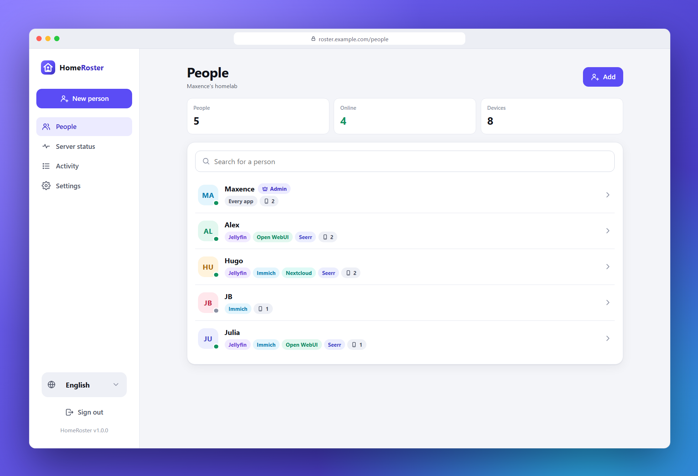
  </picture>
</p>

<table>
  <tr>
    <td width="50%" align="center">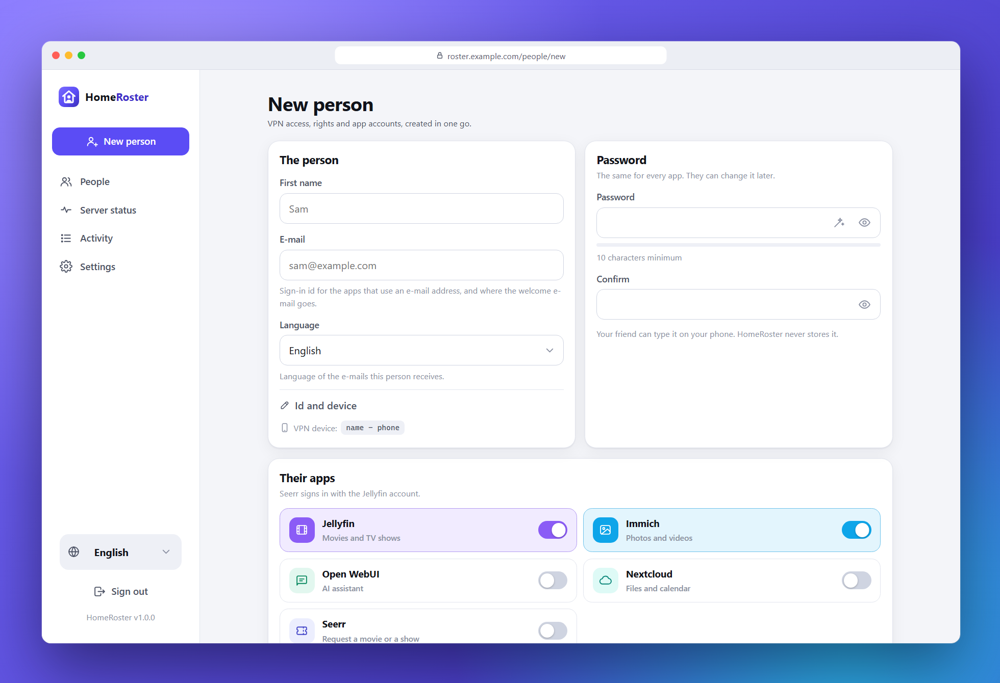<br><sub><b>One form for everything</b></sub></td>
    <td width="50%" align="center">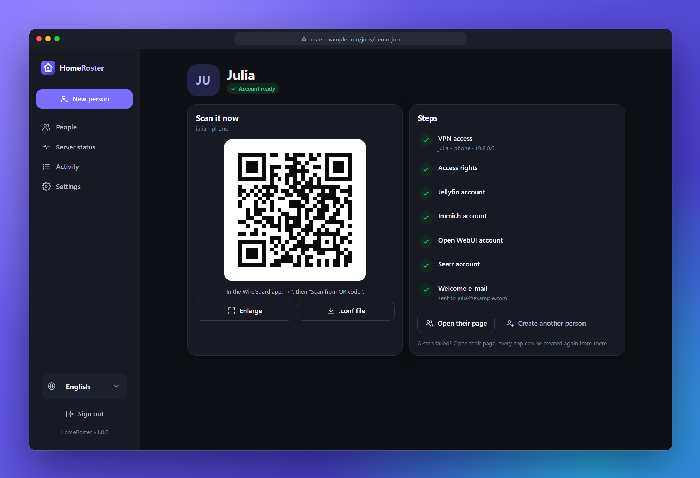<br><sub><b>Live progress, QR code ready to scan</b></sub></td>
  </tr>
  <tr>
    <td width="50%" align="center">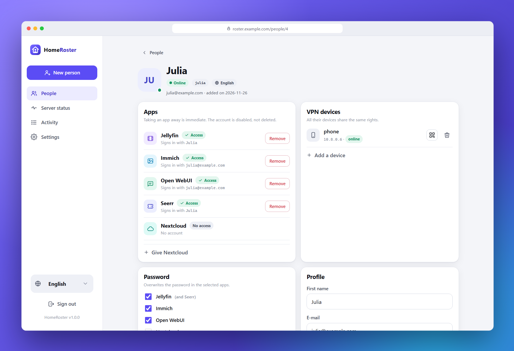<br><sub><b>Apps, devices, password and profile</b></sub></td>
    <td width="50%" align="center">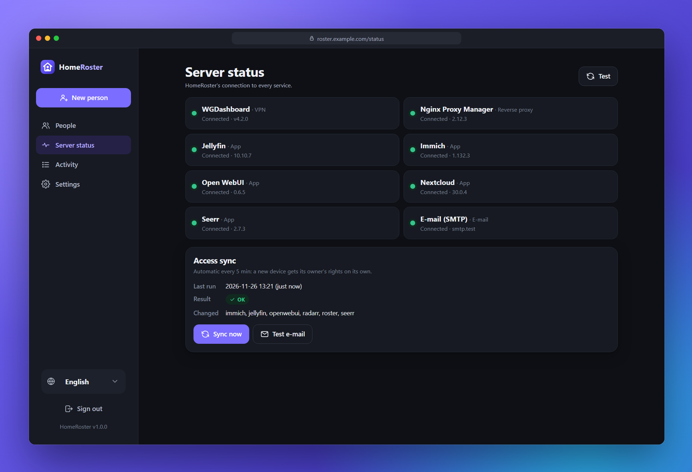<br><sub><b>Health of every connected service</b></sub></td>
  </tr>
  <tr>
    <td width="50%" align="center">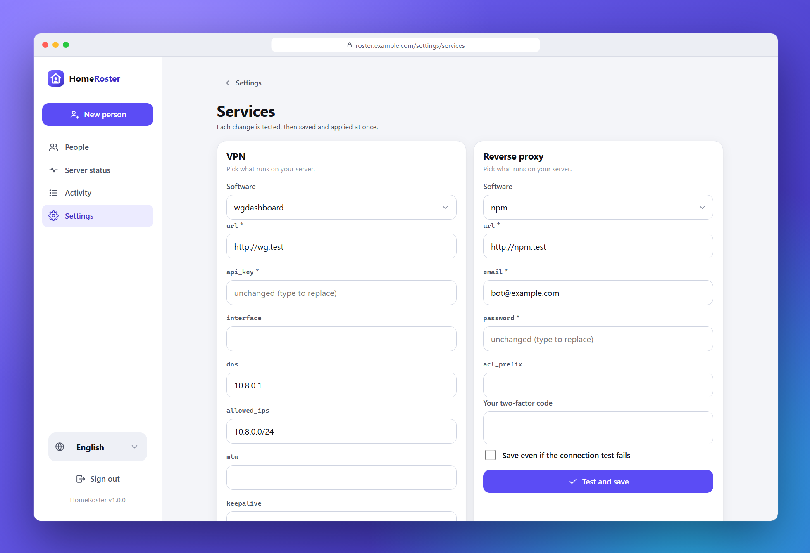<br><sub><b>VPN, proxy and apps, editable from the interface</b></sub></td>
    <td width="50%" align="center">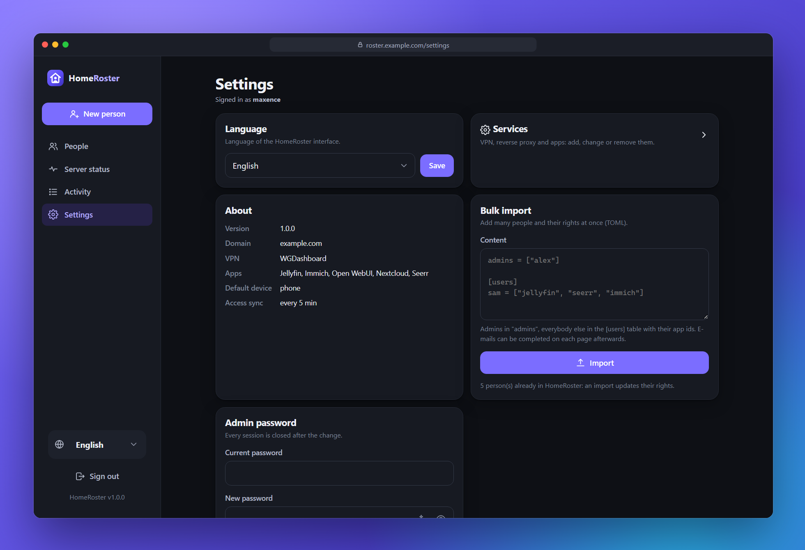<br><sub><b>Settings, with the language picker in the sidebar</b></sub></td>
  </tr>
</table>

<table>
  <tr>
    <td width="25%" align="center">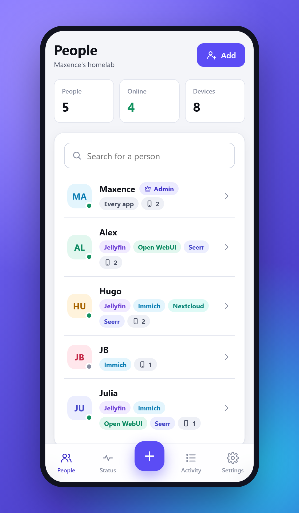<br><sub><b>On your phone</b></sub></td>
    <td width="25%" align="center">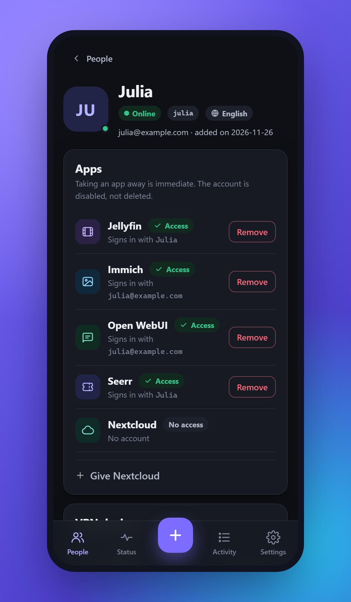<br><sub><b>Dark theme</b></sub></td>
    <td width="25%" align="center">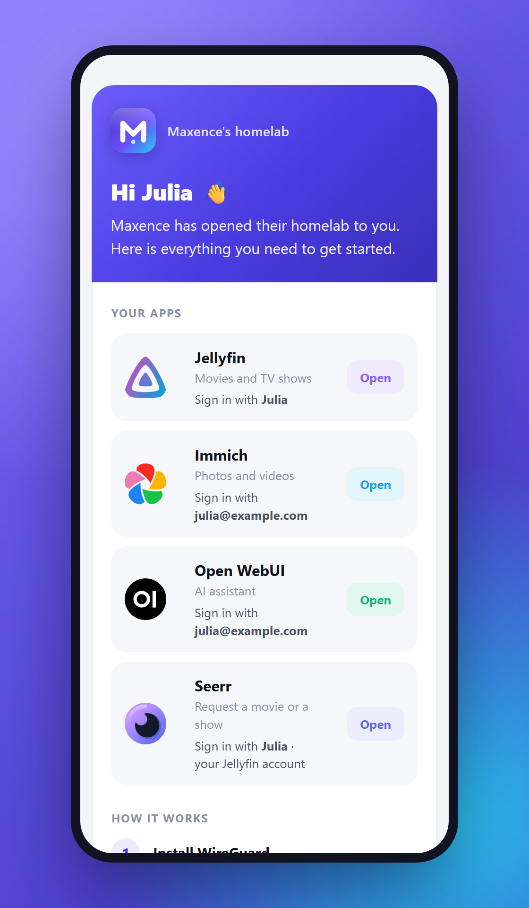<br><sub><b>The welcome e-mail</b></sub></td>
    <td width="25%" align="center">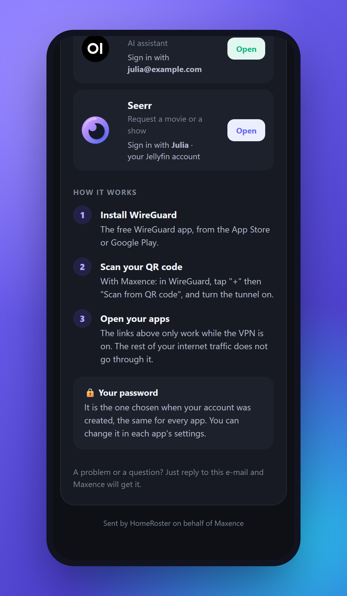<br><sub><b>…in dark mode too</b></sub></td>
  </tr>
</table>

## 🧭 How it works

<p align="center">
  <picture>
    <source media="(prefers-color-scheme: dark)" srcset="docs/assets/how-it-works-dark.png?v=2">
    
  </picture>
</p>

* Every device is named **`<person> - <device>`** (`julia - phone`). That convention links a VPN IP to a person.
* HomeRoster's database says which person may open which app. From it, each site of the reverse proxy gets an
  allow-list: the VPN IPs of the people granted that app, plus the admins, then *deny all*. Sites that are not
  managed apps (dashboards, \*arr apps, HomeRoster itself) stay **admin-only**.
* Apps are only reachable through the VPN, so the proxy rules are the real gate; app accounts are the second lock.

The full model, its safety rules and its edge cases are documented in [AGENTS.md](AGENTS.md#access-model).

## 🚀 Quick start

**Requirements:** a Docker host or a Proxmox VE server on your LAN, a VPN, a reverse proxy serving your apps,
and API keys for the apps.

| | Supported |
|---|---|
| **VPN** | [WGDashboard](https://github.com/donaldzou/WGDashboard), [wg-easy](https://github.com/wg-easy/wg-easy), plain [WireGuard](https://www.wireguard.com/) (`wg0.conf`), [PiVPN](https://pivpn.io/), [Tailscale](https://tailscale.com/), [Headscale](https://headscale.net/), [NetBird](https://netbird.io/), [ZeroTier](https://www.zerotier.com/) |
| **Reverse proxy** | [Nginx Proxy Manager](https://nginxproxymanager.com/), [Traefik](https://traefik.io/traefik/), [Caddy](https://caddyserver.com/), [nginx](https://nginx.org/), [SWAG](https://docs.linuxserver.io/general/swag/), [HAProxy](https://www.haproxy.org/), [Zoraxy](https://zoraxy.aroz.org/) |
| **Apps** | [Jellyfin](https://jellyfin.org/), [Seerr](https://github.com/seerr-team/seerr), [Immich](https://immich.app/), [Open WebUI](https://openwebui.com/), [Vaultwarden](https://github.com/dani-garcia/vaultwarden), [Home Assistant](https://www.home-assistant.io/) (OS, Container or Core), [Nextcloud](https://nextcloud.com/), [Plex](https://www.plex.tv/), [Emby](https://emby.media/), [Audiobookshelf](https://www.audiobookshelf.org/), [Navidrome](https://www.navidrome.org/) and any app with a user API |

With WGDashboard, wg-easy, WireGuard and PiVPN your family and friends scan a **QR code** holding their WireGuard file.
With Tailscale, Headscale, NetBird and ZeroTier they scan an **invitation** (a link, or a server and a one-time
key) and sign in; HomeRoster recognises their devices once they have joined. Either way the reverse proxy must
see each device's own VPN IP.

#### On Proxmox VE: one command

Open the **Shell of your Proxmox node** (web UI → your node → *Shell*, you are root) and paste:

```bash
bash -c "$(curl -fsSL https://raw.githubusercontent.com/MaxenceMARTIN45/HomeRoster/develop/scripts/proxmox/homeroster-lxc.sh)"
```

The script asks a few questions in dialog boxes, with a sensible default for each:

| Question | Default | Tip |
|---|---|---|
| Container ID, hostname | next free ID, `homeroster` | |
| Storage, disk, CPU, memory | first storage, 4 GB, 1 core, 512 MB | plenty: HomeRoster uses about 80 MB of RAM |
| Bridge and IP | `vmbr0`, DHCP | prefer a fixed IP (e.g. `192.168.1.30/24`): your reverse proxy points to it |
| Language | English | the interface and the e-mails; each person can get their own later |
| VPN, reverse proxy, apps | wg-easy, NPM, Jellyfin + Seerr + Immich | anything can be changed later in *Settings → Services* |
| Your name, domain, proxy IP | | the proxy IP is the only one allowed to tell HomeRoster a visitor's real IP |

It creates an **unprivileged Debian 12 container** (started on boot), installs HomeRoster natively (Python and
systemd, no Docker), and prints the container's address and a **setup token**. Then:

1. **Expose it**: in your reverse proxy, create a host such as `roster.example.com` → `http://<container IP>:8000`,
   restricted to your own VPN devices.
2. **Create your admin account**: open it, choose the language, enter the setup token, scan the 2FA QR code.
3. **Connect your services**: *Settings → Services*, type the URL and API key of your VPN, reverse proxy and each
   app. Every one is tested before it is saved; *Server status* shows them all.
4. **Add your first person**, a relative or a friend: **+**, their name, e-mail, a password and their apps.

**Updating:** open the container's console (`pct enter <ID>` on the node, or *Console* in the web UI) and type:

```bash
update
```

It installs the latest version from GitHub, keeps your configuration, database and services, and goes back to the
previous version automatically if the new one does not start.

<details>
<summary><b>Inside the container</b></summary>

| What | Where |
|---|---|
| Configuration | `/etc/homeroster/homeroster.yaml` (secrets in `/etc/homeroster/.env`) |
| Database and services set in the interface | `/var/lib/homeroster/` |
| Code | `/opt/homeroster` |
| Service | `systemctl status homeroster`, logs: `journalctl -u homeroster -f` |
| Restart after editing a file | `systemctl restart homeroster` |
| Setup token, if you lost it | `grep SETUP_TOKEN /etc/homeroster/.env` |

The same installer works on any Debian 12 or Ubuntu 22.04+ machine or VM, without Proxmox:
`curl -fsSL https://raw.githubusercontent.com/MaxenceMARTIN45/HomeRoster/develop/scripts/proxmox/install.sh | sudo bash`.

Plain WireGuard, PiVPN and the file-based proxies (Caddy, nginx, SWAG, HAProxy) need their files on the same
machine: in a container, prefer the API-driven ones (wg-easy, WGDashboard, Tailscale… and NPM, Traefik, Zoraxy).
To remove HomeRoster: `pct stop <ID> && pct destroy <ID>` on the node.

</details>

#### With Docker

```bash
git clone https://github.com/MaxenceMARTIN45/HomeRoster.git
cd HomeRoster
bash scripts/install.sh
```

The installer asks for the language, **which VPN, reverse proxy and apps you use**, your name, your domain and
your reverse proxy IP. It creates `config/homeroster.yaml` with only the blocks you need, lets you adjust the
service URLs, then asks for every secret the file references and stores them in `.env` (mode 600). It builds
the image, starts it and tests every connection. URLs and keys can also be entered or changed later in
*Settings → Services*.

Then create a proxy host such as `roster.example.com → http://<docker host>:8000`, open it from your phone,
pick your language, create the admin account and scan the two-factor QR code. That's it.

<details>
<summary><b>What each service needs</b></summary>

| Service | Where | What |
|---|---|---|
| **WGDashboard** | Settings → *WGDashboard API Keys* | Enable API keys and create one |
| **wg-easy** (v15+) | Admin panel → *Users* | A user without 2FA (the API uses HTTP Basic auth). DNS, allowed IPs and MTU stay set in wg-easy |
| **Nginx Proxy Manager** | *Users* → *Add User* | A dedicated user (not admin) with *Proxy Hosts* and *Access Lists* set to **Manage**, the rest *Hidden* |
| **WireGuard / PiVPN** | The WireGuard host | Run `sudo bash scripts/host-watcher.sh wireguard` there: it applies HomeRoster's changes to `wg0.conf` with `wg syncconf` and lets the container write to `/etc/wireguard` (mounted on `/wireguard`) |
| **Tailscale** | Admin console → *Settings* → *Keys* | An API access token. Each person's HomeRoster e-mail must be the one they sign in to Tailscale with |
| **Headscale** | `headscale apikeys create` | An API key, plus the public server URL the Tailscale apps of your family and friends use |
| **NetBird** | *Users* → your user → *Access tokens* | A personal access token (cloud or self-hosted management server) |
| **ZeroTier** | ZeroTier Central → *Account* → *API Access Tokens* | A token and your network ID. Invite one device at a time: HomeRoster authorizes the first new member within the hour |
| **Caddy / nginx / SWAG / HAProxy** | The proxy host | A directory mounted on `/proxy` (the installer does it), the generated file included in each site (see the YAML example) and `sudo bash scripts/host-watcher.sh proxy --dir <dir> --reload "<reload command>"` |
| **Zoraxy** | *System settings* → users | A dedicated admin account. Leave *Allow local and loopback* off in the access rules |
| **Traefik** (v2/v3) | Static configuration | The API enabled (`api.insecure` or a router to `api@internal`), a file provider directory mounted on `/traefik` (the installer does it), and the `homeroster-<app>@file` middleware on each router (see below) |
| **Jellyfin** | Dashboard → *API Keys* | A key named `HomeRoster` |
| **Seerr** | Settings → *General* | The API key |
| **Immich** | Account settings → *API Keys* (admin) | Permissions `adminUser.create`, `adminUser.read`, `adminUser.update`, `adminUser.delete` |
| **Open WebUI** | Admin panel → Settings → *General* | Enable API keys, then create one in your account settings (`sk-…`) |
| **Plex** | Your server's XML, or a browser session | Your `X-Plex-Token`. Family and friends are invited to your server by e-mail and sign in with their own Plex account |
| **Emby** | Settings → *API Keys* | A new key |
| **Audiobookshelf** | Settings → *API Keys* (or Users → your user) | A token with admin rights |
| **Navidrome** | Users | An admin account (user name and password) |
| **Vaultwarden** | `ADMIN_TOKEN` of the container | People are invited by e-mail and choose their own master password (with SMTP set in Vaultwarden they get the e-mail; otherwise they sign up with that address) |
| **Home Assistant** | Profile → *Security* → *Long-lived access tokens* | A token of an administrator. Works the same on Home Assistant OS (VM), Container (Docker) and Core (LXC). Optionally `local_only: true` |
| **SMTP** | Your provider | For Gmail, an [app password](https://myaccount.google.com/apppasswords) |

</details>

<details>
<summary><b>Traefik: attach the middlewares once</b></summary>

Traefik's API is read-only, so HomeRoster writes one `ipAllowList` middleware per site to a file Traefik
watches (`homeroster-jellyfin`, `homeroster-immich`, …), and you reference it on each router once:

```yaml
# docker-compose.yml of the app, for example Jellyfin
labels:
  - traefik.http.routers.jellyfin.rule=Host(`jellyfin.example.com`)
  - traefik.http.routers.jellyfin.middlewares=homeroster-jellyfin@file
```

Until HomeRoster has written that middleware, Traefik keeps the router disabled: it fails closed. The
*Server status* page lists every router that serves a site without its middleware.

</details>

<details>
<summary><b>Day-to-day</b></summary>

| I want to… | In HomeRoster |
|---|---|
| Add a relative or a friend | **+** → name, e-mail, password (they can type it), apps → **Create** → let them scan the QR code |
| Give or take an app | Their page → *Apps* → **Give** / **Remove** (removal is immediate; the account is disabled, not deleted) |
| Add a device (TV, laptop…) | Their page → *VPN devices* → *Add a device* → QR code |
| Reset a password | Their page → *Password* → pick the apps, type it, confirm with your 2FA code |
| Remove someone | Their page → *Remove* → type their name and your 2FA code |
| Check everything | *Server status*: every service, the last access sync and what needs attention |

</details>

## 🧩 Add any service

**From the interface:** *Settings → Services* lists your VPN, reverse proxy and apps. Add an app, change a key,
or switch to another VPN or proxy: each change is tested, saved (in the data directory, `services.yaml`, which
then replaces those sections of `homeroster.yaml`) and applied at once, after your 2FA code.

**PhotoPrism** is not built in: its free edition creates users only from the command line
(`photoprism users add`), not through its API.

HomeRoster is a set of small, replaceable parts. Each one is a plugin registered under a name used in
`homeroster.yaml` (or picked in *Settings → Services*):

| Part | Included | Replace it by implementing |
|---|---|---|
| VPN | `wgdashboard`, `wg-easy`, `wireguard`, `pivpn`, `tailscale`, `headscale`, `netbird`, `zerotier` | [`VpnProvider`](src/homeroster/providers/vpn/base.py): list / create / delete devices, hand out a client config or an invitation |
| Reverse proxy | `npm`, `traefik`, `caddy`, `nginx`, `swag`, `haproxy`, `zoraxy` | [`AccessProxy`](src/homeroster/providers/proxy/base.py): apply an IP allow-list policy to every site |
| Mailer | `smtp` | [`Mailer`](src/homeroster/providers/mail/base.py) |
| Apps | `jellyfin`, `seerr`, `immich`, `openwebui`, `vaultwarden`, `homeassistant`, `plex`, `emby`, `audiobookshelf`, `navidrome`, **`rest`** (Nextcloud…) | [`AppConnector`](src/homeroster/providers/apps/base.py): create / find / disable / delete an account |

### With YAML only

Most apps expose a user-management REST API. Describe it in `homeroster.yaml` and the generic `rest` connector
does the rest (such apps are edited in the file, not in *Settings → Services*). Here is Nextcloud:

```yaml
apps:
  nextcloud:
    connector: rest
    label: Nextcloud
    description: {en: Files and calendar, fr: Fichiers et agenda}
    icon: cloud
    logo: nextcloud                 # its official icon in the welcome e-mail
    url: http://nextcloud.lan
    auth: {type: basic, username: "${NEXTCLOUD_ADMIN_USER}", password: "${NEXTCLOUD_ADMIN_PASSWORD}"}
    headers: {OCS-APIRequest: "true"}
    success: {field: ocs.meta.statuscode, equals: [100, 200]}
    endpoints:
      create:       {method: POST, path: "/ocs/v1.php/cloud/users?format=json", id: "{username}",
                     form: {userid: "{username}", password: "{password}", email: "{email}", displayName: "{name}"}}
      set_password: {method: PUT, path: "/ocs/v1.php/cloud/users/{id}?format=json", form: {key: password, value: "{password}"}}
      disable:      {method: PUT, path: "/ocs/v1.php/cloud/users/{id}/disable?format=json"}
      enable:       {method: PUT, path: "/ocs/v1.php/cloud/users/{id}/enable?format=json"}
      delete:       {method: DELETE, path: "/ocs/v1.php/cloud/users/{id}?format=json"}
```

Docker: run `bash scripts/install.sh` again to fill in the new secrets, then `bash scripts/install.sh --update`.
Proxmox LXC: edit `/etc/homeroster/homeroster.yaml` and `/etc/homeroster/.env`, then `systemctl restart homeroster`.

### With a few lines of Python

```python
from homeroster.providers.apps.base import Account, AppConnector, Person
from homeroster.providers.base import HttpService
from homeroster.providers.registry import register_app


@register_app("mealie")
class Mealie(AppConnector):
    default_label = "Mealie"
    default_icon = "book"
    default_logo = "mealie"

    def __init__(self, app_id, options, *, domain):
        super().__init__(app_id, options, domain=domain)
        self.http = HttpService(self.label, options["url"], headers={"Authorization": f"Bearer {options['api_key']}"})

    async def create(self, person: Person, password, parent=None) -> Account:
        user = await self.http.request("POST", "/api/admin/users", expect=(200, 201), json={
            "username": person.slug, "fullName": person.name, "email": person.email, "password": password})
        return Account(user["id"], person.slug)

    async def delete(self, account: Account) -> None:
        await self.http.request("DELETE", f"/api/admin/users/{account.external_id}")
```

Put the module in the package, or anywhere on the Python path and list it under `homeroster.plugins`.
The step-by-step recipe (tests included) is in [AGENTS.md](AGENTS.md#recipes).

## 🌍 Languages

<p align="center"><b>English · 中文 · हिन्दी · Español · Français · العربية · Português · Русский · Deutsch · Italiano</b></p>

Every string lives in [`src/homeroster/locales/<code>.json`](src/homeroster/locales): English keys, translated
values, and a `_meta.direction` for right-to-left scripts. To add a language, copy `en.json` to `<code>.json`,
translate the values, restart. It shows up in the setup screen, the settings and the per-person e-mail language
automatically. A test checks that every file has the same keys and placeholders.

A person's language also reaches their app accounts when the app stores one: **Seerr** (interface language),
**Jellyfin** (preferred audio and subtitle language; its interface language is chosen in each Jellyfin app) and
**Nextcloud** (with the `language` endpoint of the YAML example). Changing it on their page updates them too.
Immich and Open WebUI keep the language in the browser, so there is nothing to set.

## ✉️ Logos in the e-mail

Set `homeroster.logo` to put your homelab's logo (PNG or JPEG) at the top of the welcome e-mail:
`/config/logo.png` with Docker (a file next to `homeroster.yaml`), `/etc/homeroster/logo.png` in the Proxmox LXC. Each
built-in app shows its official icon, downloaded once from the [dashboard-icons](https://dashboard-icons.homarr.dev)
collection and cached; set `logo:` on an app to pick another icon name, a URL, a file, or `builtin` for
HomeRoster's own pictogram (nothing is downloaded then). The app names and logos are trademarks of their owners.

## 🛡️ Security

* Admin-only interface: argon2 password **and** TOTP, replay-protected codes, 5 attempts per 15 minutes per IP.
* Sessions: `HttpOnly`, `Secure`, `SameSite=Strict` cookies, idle and absolute timeouts, new token after sign-in.
* Every form carries a CSRF token; destructive actions also require a fresh 2FA code.
* Strict Content-Security-Policy (no inline script or style), `X-Frame-Options: DENY`, no third-party resource.
* Secrets live in `.env` (mode 600), or in `services.yaml` (mode 600, data directory) once entered in
  *Settings → Services*; never in the database, the logs or a page. User passwords are never stored.
* Docker: an unprivileged user on a read-only filesystem with every capability dropped. Proxmox LXC: an
  unprivileged container and a dedicated system user with a hardened systemd unit.

Found a vulnerability? Please read [SECURITY.md](SECURITY.md).

## 🤖 For AI agents

Using Claude, Copilot, Cursor or another agent to install or adapt HomeRoster? Point it to
[**AGENTS.md**](AGENTS.md): a dense technical guide with the repository map, the invariants, the access
model, the installation procedure and recipes to add a VPN, a proxy, an app or a language.

## 🛠️ Development

```bash
python -m venv .venv && . .venv/bin/activate      # Windows: .venv\Scripts\activate
pip install -r requirements-dev.txt
pytest                                           # end-to-end tests against a simulated homelab
ruff check src tests scripts
python tests/demo_server.py                      # the real UI on http://127.0.0.1:8765, made-up data
python scripts/take_screenshots.py               # refresh the README screenshots
```

Contributions are welcome: see [CONTRIBUTING.md](CONTRIBUTING.md).

## 📄 License

[MIT](LICENSE): use it, change it, sell it, ship it. Just keep the notice.

<div align="center"><sub>Made for homelabs shared with the people we love.</sub></div>
